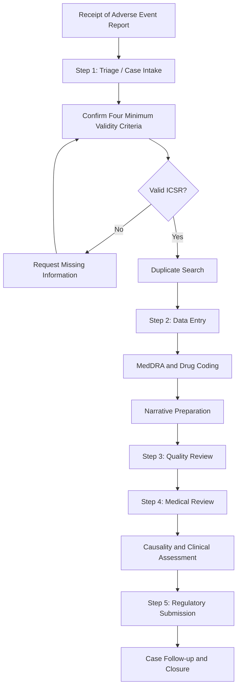

# Individual-Case-Safety-Report-ICSR-
icsr
Pharmacovigilance Case Study and Complete Drug Safety Assessment
Assignment: Simulating the Role of a Drug Safety Associate
Title
Complete Pharmacovigilance Assessment of an Ibuprofen-Induced
Gastrointestinal Bleeding Case: ADR Identification, Reporting, Causality
Assessment, and Severity Classification
1. Introduction
Pharmacovigilance is the science and activities related to the
detection, assessment, understanding, and prevention of adverse effects
or other drug-related problems.

An Individual Case Safety Report (ICSR) is a report containing
information about a suspected adverse drug reaction (ADR) in an
individual patient.

A Drug Safety Associate is responsible for receiving, validating,
processing, assessing, and reporting adverse event cases to ensure
patient safety and regulatory compliance.

This case study simulates the role of a Drug Safety Associate in
performing a complete pharmacovigilance assessment of a suspected ADR.
2. Objectives
- Identify and document the suspected adverse drug reaction.
- Assess the seriousness and severity of the reaction.
- Determine the expectedness of the ADR.
- Perform causality assessment using the WHO-UMC and Naranjo methods.
- Evaluate the clinical impact of the adverse reaction.
- Determine the appropriate regulatory reporting timeline.
- Simulate the complete ICSR case-processing workflow.
3. Detailed Case Study
Hypothetical Case
Case ID: PV-IBU-001
This is a simulated case created for academic purposes. It does not
represent an actual patient report.

Patient Information
  Parameter          Details
  Patient initials   Mr. X
Age                58 years
Gender             Male
Weight             72 kg
Medical history    Osteoarthritis
Previous history   No known history of gastrointestinal bleeding
Allergies          No known drug allergies
Suspected Drug Information
  Parameter    Details
  Drug         Ibuprofen
Indication   Pain and inflammation due to osteoarthritis
Dose         400 mg
Route        Oral
Frequency    Three times daily
Start date   01 October 2026
Stop date    05 October 2026
Concomitant Medication
  Drug                 Indication
  Paracetamol 500 mg   Occasional pain relief
Adverse Reaction Information
  Parameter                           Details
  Adverse reaction                    Gastrointestinal bleeding

  Onset date                          05 October 2026

  Symptoms                            Black tarry stools (melena),
dizziness, and weakness

  Hemoglobin                          Decreased from 13.5 g/dL to 8.9
g/dL

  Clinical diagnosis                  Suspected upper gastrointestinal
bleeding

  Treatment                           Ibuprofen discontinued; intravenous
fluids, proton pump inhibitor (PPI)
therapy, and blood transfusion

  Outcome                             Recovered after treatment
Hospitalization                     Required
Case Narrative
A 58-year-old male patient with a history of osteoarthritis was
prescribed ibuprofen 400 mg orally three times daily for pain and
inflammation. Treatment was initiated on 01 October 2026.

On 05 October 2026, the patient developed black tarry stools, dizziness,
and generalized weakness. He was admitted to the hospital, where
investigations revealed a decrease in hemoglobin concentration from 13.5
g/dL to 8.9 g/dL. The clinical findings were suggestive of upper
gastrointestinal bleeding.

Ibuprofen was discontinued immediately. The patient received intravenous
fluids, PPI therapy, and a blood transfusion. His clinical condition
gradually improved, and he recovered following treatment.

The temporal relationship between ibuprofen administration and the onset
of gastrointestinal bleeding, together with improvement after drug
withdrawal, suggested a possible association between ibuprofen and the
reported adverse reaction.

The case was considered a suspected adverse drug reaction and was
forwarded for further pharmacovigilance assessment.
4. ADR Identification and Documentation
4.1 Identification of the Suspected ADR
The reported adverse event was gastrointestinal bleeding following the
administration of ibuprofen.

Ibuprofen is a non-steroidal anti-inflammatory drug (NSAID). NSAIDs
inhibit cyclooxygenase enzymes, reducing prostaglandin synthesis. This
may decrease the protective mechanisms of the gastric mucosa and
increase the risk of gastrointestinal ulceration and bleeding.

The suspected ADR was identified based on:
- A temporal relationship between drug administration and the
  reaction.
- A clinically plausible association between ibuprofen and
  gastrointestinal bleeding.
- Improvement following discontinuation of the suspected drug.
- The absence of a documented previous history of gastrointestinal
  bleeding.
4.2 ADR Coding
For regulatory reporting, the adverse reaction should be coded using the
Medical Dictionary for Regulatory Activities (MedDRA).
  Parameter                           Classification
  Reported term                       Gastrointestinal bleeding

  MedDRA Lowest Level Term (LLT)      To be verified in the current
MedDRA version

  MedDRA Preferred Term (PT)          Gastrointestinal haemorrhage

  System Organ Class (SOC)            Gastrointestinal disorders

  Suspected drug                      Ibuprofen
Event relationship                  Suspected drug-related ADR
Note: The precise MedDRA term and code should be confirmed using the
licensed MedDRA browser or the organization's coding dictionary.
5. Seriousness Assessment
Seriousness is a regulatory classification based on the outcome or
clinical consequences of an adverse event.

An adverse event is considered serious if it results in one or more of
the following:
- Death.
- Life-threatening condition.
- Inpatient hospitalization or prolongation of existing
  hospitalization.
- Persistent or significant disability or incapacity.
- Congenital anomaly or birth defect.
- Other medically important conditions.
Seriousness Classification of the Case
  Seriousness criterion               Assessment
  Death                               No

  Life-threatening                    Not documented

  Hospitalization                     Yes

  Prolongation of hospitalization     Not applicable

  Disability                          No

  Congenital anomaly                  Not applicable
Other medically important condition Not required to establish
seriousness
Serious ADR

Justification: The patient required inpatient hospitalization for
the management of gastrointestinal bleeding. Therefore, the case meets
the seriousness criterion of hospitalization.

The case should be classified as a serious adverse drug reaction, even
though the patient recovered.
6. Severity Classification
Severity describes the intensity of the adverse reaction. It is
different from seriousness.

The Hartwig and Siegel Severity Assessment Scale can be used to classify
ADR severity.
  Severity level                      Description
  Level 1                             Mild reaction requiring no change
in treatment

  Level 2                             Reaction requiring discontinuation
or change of drug, without
additional treatment

  Level 3                             Reaction requiring treatment,
without hospitalization

  Level 4                             Reaction requiring hospitalization
or prolongation of hospitalization

  Level 5                             Reaction requiring intensive
medical care

  Level 6                             Reaction causing permanent harm
Level 7                             Reaction resulting in death
Severity Assessment of the Case
The patient required hospitalization, discontinuation of ibuprofen,
intravenous treatment, and blood transfusion.

Moderate severity --- Hartwig Level 4

Justification: The reaction required hospitalization and medical
intervention. Based on the available case information, it is classified
as moderate severity, corresponding to Level 4 of the Hartwig and Siegel
scale.

The patient did not require intensive care, and no permanent harm or
death was reported.

The Hartwig classification is based on the documented clinical course. A
different level may be appropriate if additional clinical details
indicate intensive care or other complications.
7. Expectedness Assessment
Expectedness determines whether the reported adverse reaction is
consistent with the applicable reference safety information for the
suspected medicinal product.

An ADR is classified as:
- Expected: The reaction is consistent with the applicable product
  information.
- Unexpected: The reaction is not consistent with the applicable
  product information, or its nature, severity, or specificity is not
  described.
Expectedness Assessment of Ibuprofen
Ibuprofen is associated with gastrointestinal adverse effects, including
gastrointestinal ulceration and bleeding.

For this simulated assessment, the applicable reference safety
information is assumed to list gastrointestinal bleeding as a known
adverse reaction.
  Parameter                           Assessment
  Reference safety information        Assumed to list gastrointestinal
bleeding

  Reported reaction                   Gastrointestinal bleeding

  Nature of reaction                  Consistent with reference
information
Expectedness                        Expected
Expected ADR

Justification: Gastrointestinal bleeding is a recognized adverse
reaction associated with ibuprofen. Therefore, the reaction is
considered expected under the assumed reference safety information.

In an actual case, expectedness must be verified against the applicable
current Summary of Product Characteristics (SmPC), Prescribing
Information, or Investigator's Brochure. The seriousness or severity of
the reported event does not automatically make it unexpected.
8. Causality Assessment
Causality assessment is the process of determining the likelihood that a
medicinal product caused a suspected adverse drug reaction.

Two commonly used approaches are:
- WHO-UMC Causality Assessment System.
- Naranjo Adverse Drug Reaction Probability Scale.
8.1 WHO-UMC Causality Assessment
The WHO-UMC system classifies causality into categories such as Certain,
Probable/Likely, Possible, Unlikely, Conditional/Unclassified, and
Unassessable/Unclassifiable.
  Criterion                           Case assessment
  Temporal relationship               Reaction occurred after ibuprofen
initiation

  Known pharmacological association   Gastrointestinal bleeding is a
recognized NSAID adverse reaction

  Dechallenge                         Improvement after discontinuation

  Rechallenge                         Not performed

  Alternative causes                  Not fully investigated

  Objective evidence                  Melena and decreased hemoglobin
Causality category                  Probable/Likely
Conclusion: The suspected relationship between ibuprofen and
gastrointestinal bleeding is classified as Probable/Likely under
WHO-UMC, based on the available information.

This classification is provisional because the case does not include
complete investigations to exclude alternative causes of
gastrointestinal bleeding.
8.2 Naranjo Causality Assessment
The Naranjo scale consists of 10 questions used to assess the
probability of an ADR.

Scoring: Answers are scored according to the Naranjo algorithm.
Depending on the question, a response may receive +1, +2, -1, or 0.
               No. Naranjo question    Answer                         Score

                 1 Are there previous  Yes                               +1
                   conclusive reports                  
                   of this reaction?                   

                 2 Did the reaction    Yes                               +2
                   occur after the                     
                   suspected drug was                  
                   administered?                       

                 3 Did the reaction    Yes                               +1
                   improve after the                   
                   drug was                            
                   discontinued?                       

                 4 Did the reaction    Do not know                        0
                   reappear upon                       
                   readministration?                   

                 5 Are there           Do not know                        0
                   alternative causes                  
                   that could have                     
                   caused the                          
                   reaction?                           

                 6 Did the reaction    Do not know                        0
                   reappear when a                     
                   placebo was given?                  

                 7 Was the drug        Do not know                        0
                   detected in toxic                   
                   concentrations?                     

                 8 Was the reaction    Do not know                        0
                   more severe when                    
                   the dose was                        
                   increased or less                   
                   severe when                         
                   decreased?                          

                 9 Did the patient     Do not know                        0
                   have a similar                      
                   reaction to the                     
                   same or similar                     
                   drug previously?                    

                10 Was the adverse     Yes                               +1
                   event confirmed by                  
                   objective evidence?                 

                   **Total score**                                    **5**

Naranjo Score Interpretation
 Total score Causality category

9 or greater Definite
        5--8 Probable
        1--4 Possible
           0 Doubtful
Probable --- Score 5

Conclusion: The Naranjo score of 5 indicates a probable relationship
between ibuprofen and gastrointestinal bleeding.

The score supports the WHO-UMC assessment. However, causality tools
support clinical judgment and do not establish definitive proof of
causation.
9. ICSR Validity Assessment
Before processing an Individual Case Safety Report, the Drug Safety
Associate must confirm that the report contains the four minimum
validity criteria:
1. An identifiable patient.
2. An identifiable reporter.
3. A suspected medicinal product.
4. A suspected adverse reaction.
Validity Assessment of the Case
  Validity criterion      Case information        Status
  Identifiable patient    58-year-old male, Mr. X Present

  Identifiable reporter   Treating physician ---  Present
assumed for simulation  

  Suspected medicinal     Ibuprofen 400 mg        Present
product                                         
Suspected adverse       Gastrointestinal        Present
reaction                bleeding
Validity conclusion: The case meets all four minimum ICSR validity
criteria and can be processed as a valid safety report.

The reporter information is assumed for this simulation. In an actual
case, the reporter's identity and contact details must be obtained and
documented appropriately.
10. Complete Case Processing Workflow
The case-processing workflow follows the steps described in the provided
pharmacovigilance training transcript.

Step 1: Triage or Case Intake
The Drug Safety Associate receives the adverse event report from a
healthcare professional, patient, clinical trial, literature source, or
spontaneous reporting system.

Responsibilities:
- Record the date of initial receipt.
- Confirm the four minimum validity criteria.
- Identify the suspected medicinal product and reported ADR.
- Assess the seriousness of the case.
- Prioritize serious and life-threatening cases.
- Search the safety database for duplicate reports.
- Create the case in the safety database.
For the simulated case, the report is valid and serious. Therefore, it
should be prioritized for further processing.
Step 2: Data Entry
The Data Entry Associate enters the information into the safety
database.

Responsibilities:
- Enter patient demographic information.
- Record medical history and relevant clinical information.
- Enter suspected and concomitant medication details.
- Document the adverse reaction and its onset date.
- Record laboratory results and clinical investigations.
- Code medical terms using MedDRA.
- Code medicinal products using the appropriate drug dictionary.
- Prepare the case narrative.
- Raise queries for missing or unclear information.
Step 3: Quality Review
The Quality Reviewer checks the accuracy and completeness of the entered
data.

Quality review checklist:
- [ ] Patient demographics are entered accurately.
- [ ] Suspected drug information is complete.
- [ ] ADR description and onset date are documented.
- [ ] Seriousness criteria are correctly assessed.
- [ ] Expectedness is supported by reference safety information.
- [ ] MedDRA coding is appropriate.
- [ ] Causality assessment is documented.
- [ ] Case narrative is consistent with source information.
- [ ] Missing information queries are raised where necessary.
Checklist progress: 0 of 9 quality checks completed.
Step 4: Medical Review
The Medical Reviewer evaluates the clinical aspects of the case.

Responsibilities:
- Review the clinical narrative.
- Assess the medical plausibility of the reaction.
- Evaluate alternative causes.
- Review the causality assessment.
- Confirm seriousness and severity.
- Review expectedness.
- Provide medical comments.
- Recommend additional follow-up information where required.
For this case, the Medical Reviewer would assess whether the
gastrointestinal bleeding could be associated with other conditions,
concomitant medications, or other possible causes.
Step 5: Regulatory Submission
The Submission Associate verifies that the case is complete and meets
the relevant regulatory reporting requirements.

Responsibilities:
- Perform the final validity check.
- Confirm the seriousness and reporting category.
- Verify the applicable regulatory timeline.
- Confirm the report is ready for submission.
- Submit the ICSR to the appropriate regulatory authority.
- Record the submission date and acknowledgement.
- Maintain the case for follow-up.
11. Regulatory Reporting Assessment
The date on which the company first receives a valid adverse event
report is known as Day 0 or the regulatory clock start date.

For this simulated case:
  Parameter                           Details
  Initial receipt date                05 October 2026

  Regulatory clock start date         05 October 2026

  Seriousness                         Serious

  Event category                      Hospitalization

  Expectedness                        Expected

  Reporting priority                  High
Reporting requirement               Expedited reporting, subject to
applicable regulations
Reporting Timelines Based on the Provided Training Transcript
  Case category                             Reporting timeline
  Fatal or life-threatening serious cases   7 calendar days
Other serious cases                       15 working days
Non-serious cases                         90 days

The case in this assignment is serious due to hospitalization.
Therefore, the applicable reporting timeline must be determined
according to the relevant regulatory framework.

Important regulatory note: These timelines are taken from the
provided training transcript. They should not be treated as universal
reporting deadlines. Actual timelines depend on the jurisdiction,
reporting source, product type, and applicable regulations. For example,
standard EU post-marketing reporting requirements generally use 15
calendar days for serious cases and 90 calendar days for non-serious
cases. The 7-day fatal/life-threatening timeline described in the
transcript may apply to a specific framework or reporting context.

The applicable regulatory requirements must be verified before actual
submission.
12. Clinical Impact Assessment
The adverse reaction had a significant impact on the patient's health
and required immediate medical intervention.
  Clinical impact                     Assessment
  Patient safety                      Significant risk due to blood loss

  Hemoglobin reduction                13.5 g/dL to 8.9 g/dL

  Treatment modification              Ibuprofen discontinued

  Medical intervention                IV fluids, PPI therapy, and blood
transfusion

  Hospitalization                     Required

  Recovery                            Recovered after treatment
Preventability                      Potentially preventable; further
information required
Preventability Assessment
The event may have been preventable through appropriate assessment of
gastrointestinal risk factors before initiating NSAID therapy.

Preventive measures include:
- Assessing the patient's history of peptic ulcer disease or
  gastrointestinal bleeding.
- Prescribing the lowest effective NSAID dose for the shortest
  possible duration.
- Considering gastroprotective therapy in patients at increased risk.
- Monitoring for symptoms such as melena, hematemesis, dizziness, and
  weakness.
- Educating patients about the warning signs of gastrointestinal
  bleeding.
- Avoiding unnecessary concomitant medications that increase bleeding
  risk.
The case cannot be definitively classified as preventable without
knowing whether appropriate risk assessment and prescribing precautions
were followed.
13. Final Case Assessment Summary
Final Pharmacovigilance Assessment
  Assessment parameter     Final classification
  Suspected drug           Ibuprofen
ADR                      Gastrointestinal bleeding
ADR seriousness          Serious
Severity                 Moderate --- Hartwig Level 4
Expectedness             Expected
WHO-UMC causality        Probable/Likely
Naranjo score            5 --- Probable
Clinical outcome         Recovered
Regulatory clock start   05 October 2026
Reporting category       Serious ICSR
Case validity            Valid
14. Conclusion
This pharmacovigilance case study demonstrates the complete assessment
of a suspected ibuprofen-induced gastrointestinal bleeding event.

The patient developed gastrointestinal bleeding following ibuprofen
administration, resulting in hospitalization and the need for medical
intervention. The reaction was classified as serious due to
hospitalization and moderate in severity according to the Hartwig and
Siegel scale.

The expectedness assessment indicated that gastrointestinal bleeding was
an expected adverse reaction based on the assumed reference safety
information. The WHO-UMC system classified the causal relationship as
Probable/Likely, while the Naranjo scale produced a score of 5,
indicating a probable association.

The case was considered a valid Individual Case Safety Report and was
processed through the standard pharmacovigilance workflow, including
triage, data entry, quality review, medical review, and regulatory
submission.

This assessment highlights the importance of accurate ADR
identification, proper documentation, clinical evaluation, and timely
regulatory reporting in ensuring medication safety.
